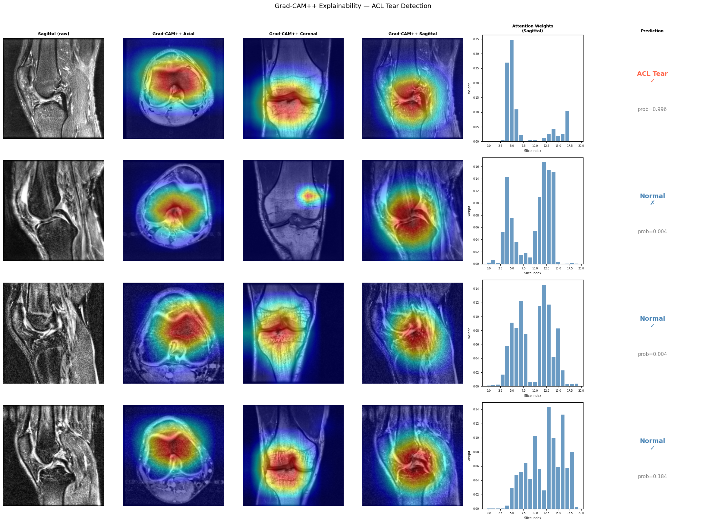
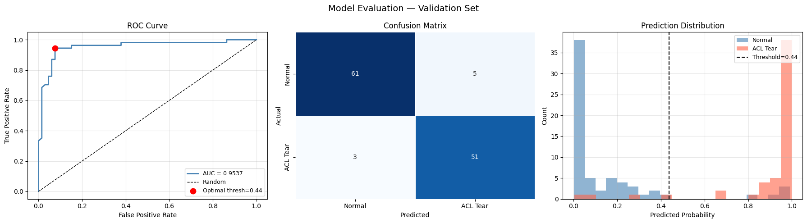
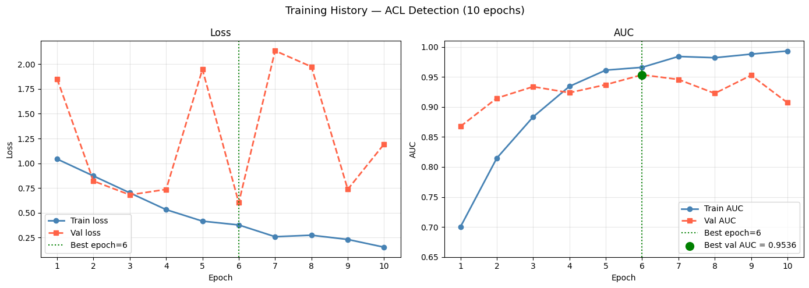
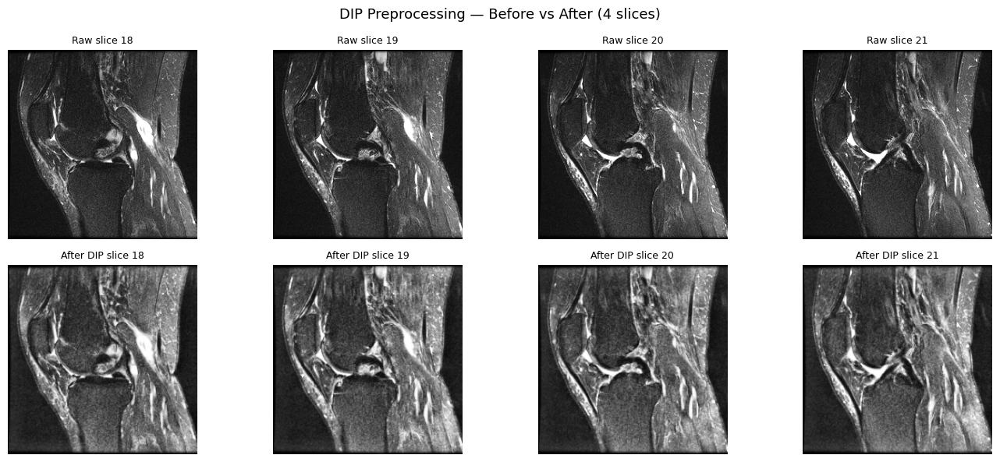

# Cross-Scanner ACL Injury Detection using Multi-View MRI Learning

Deep-learning system that detects **anterior cruciate ligament (ACL) tears** from 3-plane knee MRI (axial, coronal, sagittal) on the Stanford **MRNet** dataset, with **Grad-CAM++** and **slice-attention** explainability and a web interface for uploading scans.

<p align="center">
  <b>Val AUC 0.954</b> · Accuracy 93.3% · Sensitivity 94.4% · Specificity 92.4%
</p>

**Web interface:** https://srk-ch.github.io/Software-deployment/ — needs the Flask backend running (see [Live inference](#live-inference)).



---

## Highlights

- **Multi-view architecture** — a separate ResNet18 encoder per MRI plane, learnable attention pooling over slices, and late fusion of all three planes.
- **Classical DIP preprocessing** — Gaussian denoising, CLAHE contrast enhancement and per-volume z-score normalisation before any deep learning.
- **Explainable** — Grad-CAM++ heatmaps localise the intercondylar notch (where the ACL sits); attention weights show which slices drove the decision.
- **Deployable** — Flask REST API (`/predict`, `/health`) and a single-page frontend; Dockerfile included for container hosting.

## Results (MRNet validation set, n = 120)

| Metric | Value |
|---|---|
| ROC-AUC | **0.9537** |
| Accuracy | 93.33% |
| Sensitivity (recall) | 94.44% |
| Specificity | 92.42% |
| PPV (precision) | 91.07% |
| NPV | 95.31% |
| Macro F1 | 0.9329 |
| Confusion matrix | TP 51 · TN 61 · FP 5 · FN 3 |

Decision threshold **0.4377**, chosen with Youden's J on the ROC curve. Best checkpoint is from epoch 6 of 10.




## Method

```
 Axial  ─┐                         ┌─ ResNet18 → 512-d/slice → Attention pool ─┐
 Coronal ┼─ DIP preprocessing ─────┼─ ResNet18 → 512-d/slice → Attention pool ─┼─ concat 1536-d → MLP (256→64→1) → P(tear)
 Sagittal┘  (20 slices / plane)    └─ ResNet18 → 512-d/slice → Attention pool ─┘
```

**Data:** MRNet. Train has 1,130 exams (208 ACL tears) and validation has 120 exams (54 tears).

**Preprocessing:**
- Resize each slice from 256 to 224 with bilinear interpolation.
- Gaussian denoise (σ = 0.5).
- CLAHE (clip limit 1.5, 16×16 tiles).
- Per-volume z-score normalisation.
- Sample 20 evenly spaced slices per plane.



**Augmentation (training only, albumentations):** rotation ±10°, horizontal flip, shift-scale, elastic deformation, brightness/contrast and Gaussian noise.

**Model:**
- Encoders are ImageNet-pretrained ResNet18s. The first conv layer's weights are averaged to accept a single grayscale channel.
- Each plane has a 2-layer tanh attention pool over its slices.
- The classifier has dropout 0.3.
- 34.1M parameters in total.

**Training:**
- Loss: `BCEWithLogitsLoss` with `pos_weight = 4.43` to handle class imbalance.
- Optimiser: Adam (lr 1e-4, weight decay 1e-5) with ReduceLROnPlateau on val AUC.
- Mixed precision, early stopping (patience 7), seed 42.
- Trained on an RTX 4070 laptop GPU.

## Repository structure

```
├── notebooks/acl_mrnet_training.ipynb   # full pipeline: data, DIP, training, evaluation, Grad-CAM++
├── backend/
│   ├── app.py                          # Flask inference API + Grad-CAM++
│   └── requirements.txt
├── docs/index.html                     # web frontend (GitHub Pages-ready)
├── assets/                             # figures used in this README
└── Dockerfile                          # container for hosting the API
```

## Getting started

```bash
git clone https://github.com/gkarthik04/ACL-Injury-Detection.git
cd ACL-Injury-Detection
python -m venv .venv && source .venv/bin/activate      # Windows: .venv\Scripts\activate
pip install -r backend/requirements.txt
```

**Model weights:** the trained checkpoint (`best_model.pth`, about 135 MB) is too large for the git repo. Download it from the [Releases](../../releases) page and place it at `backend/best_model.pth`. Alternatively, set the `MODEL_PATH` environment variable to its location.

```bash
python backend/app.py            # serves the UI + API on http://localhost:7860
```

Open http://localhost:7860, upload the three plane volumes (`.npy` files shaped `slices × 256 × 256`, as in MRNet), and run the analysis.

### API

| Endpoint | Method | Description |
|---|---|---|
| `/health` | GET | Model status, device, threshold |
| `/predict` | POST | `multipart/form-data` with `axial`, `coronal`, `sagittal` `.npy` files. Returns the label, probability, per-plane attention weights and base64 Grad-CAM++ overlays |

```bash
curl -X POST http://localhost:7860/predict \
  -F axial=@0001_axial.npy -F coronal=@0001_coronal.npy -F sagittal=@0001_sagittal.npy
```

### Live inference

The frontend in `docs/` can be served by GitHub Pages. To make it run real predictions:

1. Deploy the API with the `Dockerfile` to any container host, for example a Hugging Face Space using the Docker SDK on port 7860.
2. Set `HOSTED_BACKEND` in `docs/index.html` to that URL, or open the page with `?api=<backend-url>`.

### Training from scratch

1. Request and download [MRNet](https://stanfordmlgroup.github.io/competitions/mrnet/). The dataset is not redistributed here under its research-use agreement.
2. Set `DATA_ROOT` in Block 2 of the notebook.
3. Run the notebook top to bottom.

## Limitations

- Mild overfitting after epoch 6 (validation loss fluctuates), and the validation set is small (n = 120).
- Some subtle or partial tears get diffuse Grad-CAM activation and are missed.
- Single-dataset evaluation. Cross-scanner generalisation needs external validation.
- **Research prototype only — not a medical device and not for clinical use.**

## Future work

Self-supervised pretraining on unlabeled MRI · test-time augmentation · multi-task learning across MRNet labels (ACL, meniscus, abnormal) · model compression for PACS integration.

## Team

**G Sai Karthikeya** · **Ch Seetharam Kartheek** ([@srk-ch](https://github.com/srk-ch)) · **J Nithya Aishwarya**
Guided by **Dr. Sibendu Samanta**, Department of CSE, SRM University AP.

Original deployment repo: [srk-ch/Software-deployment](https://github.com/srk-ch/Software-deployment).

## Acknowledgements

Bien, N. *et al.* "Deep-learning-assisted diagnosis for knee magnetic resonance imaging: Development and retrospective validation of MRNet." *PLOS Medicine* 15(11), 2018. Dataset from the Stanford ML Group.
